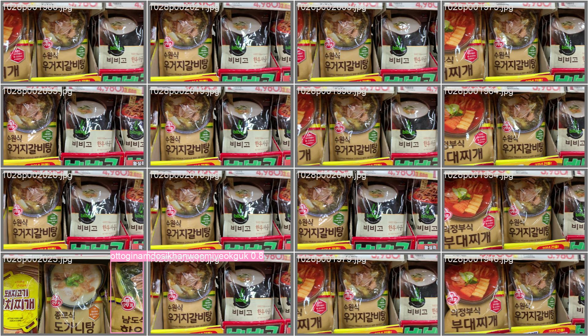
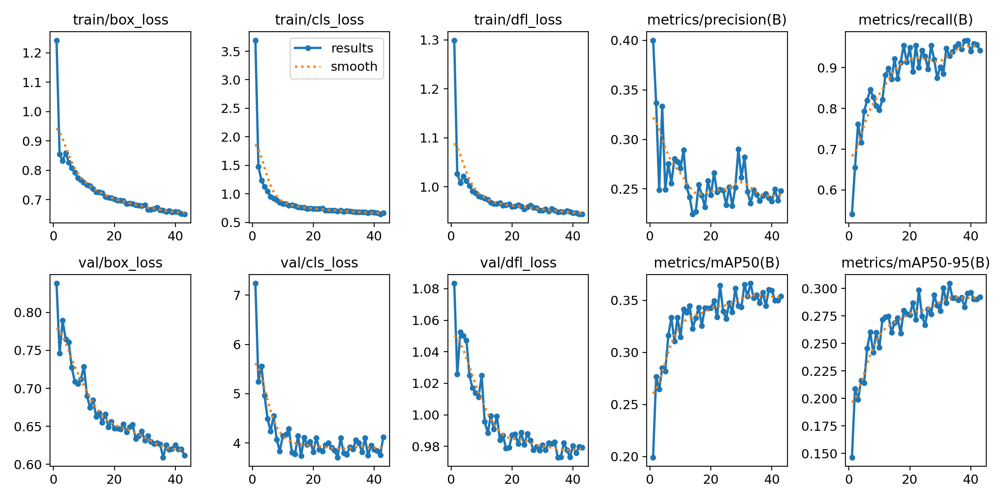

# Market YOLO Checkout

**Object detection을 이용한 자동 결제 시스템** · 2023 경희대학교 인공지능프로그래밍(AI100200) 5조 (안지민, 이강훈, 한승석)

장바구니 사진 한 장에서 상품을 한꺼번에 인식하고, 가격표(`Price.xlsx`)와 맞춰 총 결제 금액을 계산합니다. 상품을 하나씩 바코드로 찍느라 계산대 줄이 길어지는 불편함에서 출발한 프로젝트입니다.

<p>
  
  
</p>

## 동작 방식

1. YOLOv8s가 이미지에서 상품을 검출합니다 (385개 클래스).
2. 검출된 클래스별 개수를 셉니다.
3. `Price.xlsx`의 상품명·가격과 매칭해 품목별 개수·단가와 총 금액을 출력합니다.


## 데이터

- 서울 열린데이터 광장 「상품 표지 이미지 AI 학습 데이터셋」 (과자·소스·면류 등 7개 카테고리)
- 전처리 (`preprocess/`)
  - `1.labelling.py`: 카테고리별로 0번부터 매겨진 클래스 번호를 누적 개수만큼 밀어서 하나로 통합
  - `2.train_test_splitting.py`, `3.train_validation_splitting.py`: train/test 8:2, 다시 train/val 8:2 분할
  - `4.split_images_labels.py`: YOLO 형식의 `images/`, `labels/` 폴더 구조로 정리

## 모델 선정과 튜닝

DETR, Faster R-CNN, YOLO를 비교했습니다. 한정된 자원과 시간 안에 학습할 수 있고 실시간 검출이 가능한 YOLOv8을 골랐습니다.

| 모델 | batch 16 | batch 32 | batch 64 |
|---|---|---|---|
| YOLOv8n | 0.966 | 0.949 | 0.962 |
| YOLOv8s | 0.963 | **0.967** | 0.964 |

| YOLOv8s imgsz | 640 | 720 | 840 |
|---|---|---|---|
| 성능 | **0.963** | 0.953 | 0.958 |

최종 설정: YOLOv8s, `batch=32`, `imgsz=640`, `lr0=0.01`, `epochs=150`, `patience=10` (44 epoch에서 조기 종료)

## 결과와 한계

- recall 0.93, mAP50 0.366, mAP50-95 0.305
- 실제 마트에서 장바구니 사진을 찍어 테스트했습니다. 상품 표지가 잘 보이면 정확히 인식했지만, 표지가 가려지거나 상품이 많이 겹치면 놓쳤습니다.
- 개선 방향: 360도 촬영 이미지와 augmentation을 더한 대용량 데이터셋, grid search를 이용한 하이퍼파라미터 탐색

## 실행

```bash
pip install ultralytics pandas openpyxl opencv-python
python "Payment(main).py"
```

`Payment(main).py` 안의 가중치 경로를 `Best_model/weights/best.pt`로, 이미지 경로를 `test_image/` 안의 파일로 맞춰서 실행하세요. 학습은 `yolo_train.py`와 `item.yaml`로 합니다.

| 파일 | 내용 |
|---|---|
| `Payment(main).py` | 검출 → 개수 집계 → 가격 계산 메인 코드 |
| `yolo_train.py`, `item.yaml`, `class.txt` | 학습 스크립트, 데이터 설정, 클래스 목록 |
| `Best_model/` | 최종 모델 가중치와 학습 곡선·혼동행렬 |
| `make_graph (hyperparameter).py` | 하이퍼파라미터 실험 비교 그래프 |

학습 데이터셋은 용량 때문에 포함하지 않았습니다.

## 역할 (이강훈)

팀 역할 분배, 데이터 수집, 모델 조사·학습, `item.yaml` 작성, imgsz 튜닝, `Payment(main).py` 구현, 실제 마트 사진 테스트
